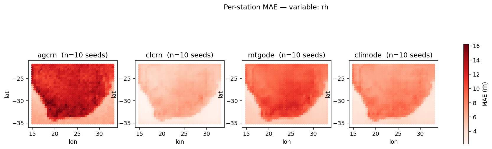
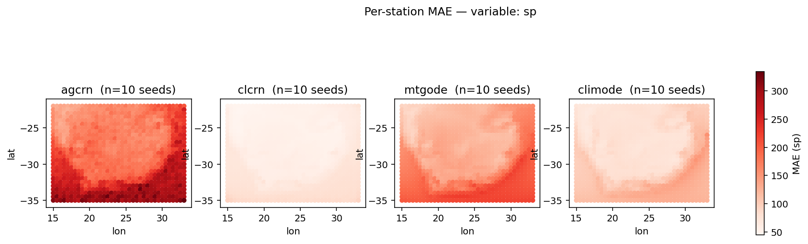
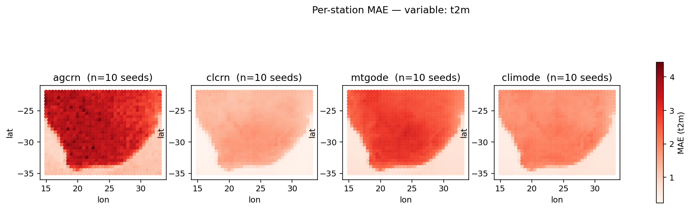
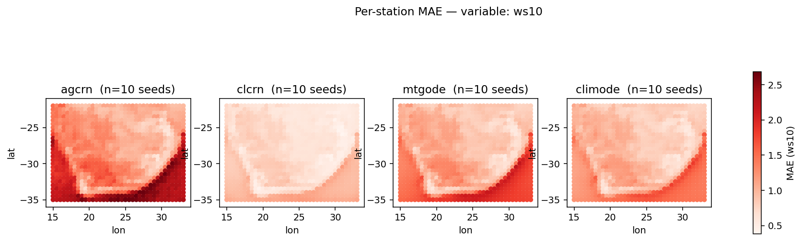
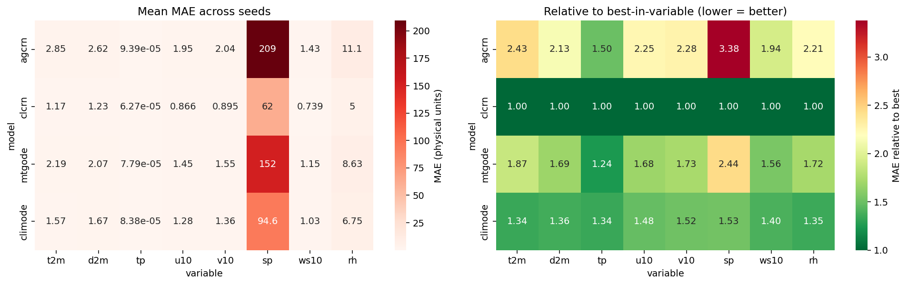
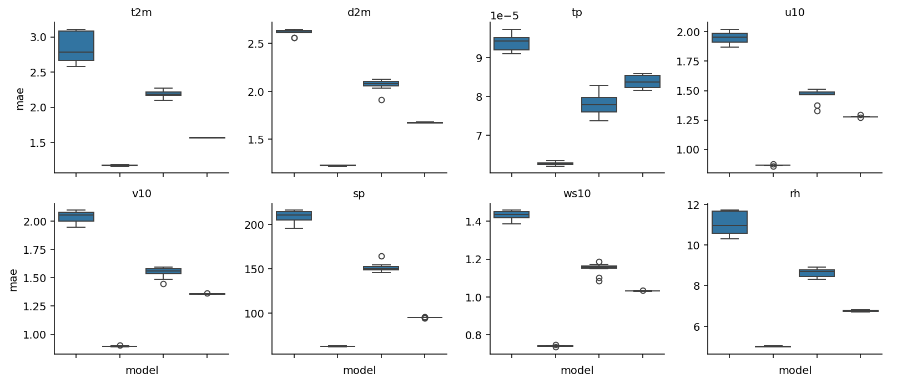
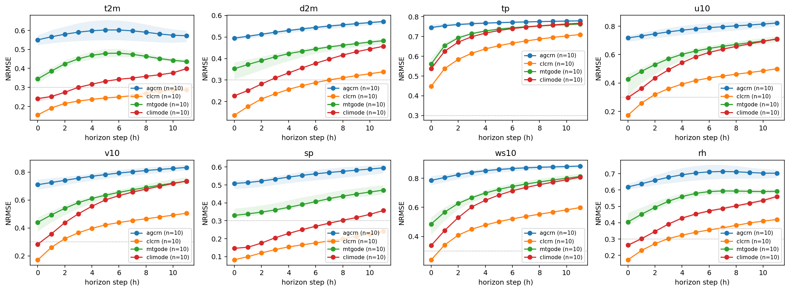

# WeatherFLOW production matrix — analysis report

## Seed counts

| model | n_seeds |
|-------|---------|
| agcrn | 10 |
| clcrn | 10 |
| mtgode | 10 |
| climode | 10 |

## Mean MAE per variable (mean +/- std across seeds)

| model | t2m | d2m | tp | u10 | v10 | sp | ws10 | rh |
|---|---|---|---|---|---|---|---|---|
| agcrn | 2.85 +/- 0.22 | 2.62 +/- 0.031 | 9.39e-05 +/- 2.2e-06 | 1.95 +/- 0.051 | 2.04 +/- 0.054 | 209 +/- 6.9 | 1.43 +/- 0.026 | 11.1 +/- 0.57 |
| clcrn | 1.17 +/- 0.0058 | 1.23 +/- 0.0034 | 6.27e-05 +/- 4.3e-07 | 0.866 +/- 0.004 | 0.895 +/- 0.0036 | 62 +/- 0.4 | 0.739 +/- 0.0029 | 5 +/- 0.022 |
| mtgode | 2.19 +/- 0.053 | 2.07 +/- 0.06 | 7.79e-05 +/- 2.9e-06 | 1.45 +/- 0.058 | 1.55 +/- 0.047 | 152 +/- 5.2 | 1.15 +/- 0.032 | 8.63 +/- 0.2 |
| climode | 1.57 +/- 0.0024 | 1.67 +/- 0.0049 | 8.38e-05 +/- 1.7e-06 | 1.28 +/- 0.0061 | 1.36 +/- 0.0035 | 94.6 +/- 0.48 | 1.03 +/- 0.002 | 6.75 +/- 0.041 |

## Pairwise Wilcoxon signed-rank tests (paired by seed, p-values)

| variable | model_a | model_b | n | p |
|----------|---------|---------|---|---|
| d2m | agcrn | clcrn | 10 | 0.00195 ** |
| d2m | agcrn | climode | 10 | 0.00195 ** |
| d2m | agcrn | mtgode | 10 | 0.00195 ** |
| d2m | clcrn | climode | 10 | 0.00195 ** |
| d2m | clcrn | mtgode | 10 | 0.00195 ** |
| d2m | climode | mtgode | 10 | 0.00195 ** |
| rh | agcrn | clcrn | 10 | 0.00195 ** |
| rh | agcrn | climode | 10 | 0.00195 ** |
| rh | agcrn | mtgode | 10 | 0.00195 ** |
| rh | clcrn | climode | 10 | 0.00195 ** |
| rh | clcrn | mtgode | 10 | 0.00195 ** |
| rh | climode | mtgode | 10 | 0.00195 ** |
| sp | agcrn | clcrn | 10 | 0.00195 ** |
| sp | agcrn | climode | 10 | 0.00195 ** |
| sp | agcrn | mtgode | 10 | 0.00195 ** |
| sp | clcrn | climode | 10 | 0.00195 ** |
| sp | clcrn | mtgode | 10 | 0.00195 ** |
| sp | climode | mtgode | 10 | 0.00195 ** |
| t2m | agcrn | clcrn | 10 | 0.00195 ** |
| t2m | agcrn | climode | 10 | 0.00195 ** |
| t2m | agcrn | mtgode | 10 | 0.00195 ** |
| t2m | clcrn | climode | 10 | 0.00195 ** |
| t2m | clcrn | mtgode | 10 | 0.00195 ** |
| t2m | climode | mtgode | 10 | 0.00195 ** |
| tp | agcrn | clcrn | 10 | 0.00195 ** |
| tp | agcrn | climode | 10 | 0.00195 ** |
| tp | agcrn | mtgode | 10 | 0.00195 ** |
| tp | clcrn | climode | 10 | 0.00195 ** |
| tp | clcrn | mtgode | 10 | 0.00195 ** |
| tp | climode | mtgode | 10 | 0.00195 ** |
| u10 | agcrn | clcrn | 10 | 0.00195 ** |
| u10 | agcrn | climode | 10 | 0.00195 ** |
| u10 | agcrn | mtgode | 10 | 0.00195 ** |
| u10 | clcrn | climode | 10 | 0.00195 ** |
| u10 | clcrn | mtgode | 10 | 0.00195 ** |
| u10 | climode | mtgode | 10 | 0.00195 ** |
| v10 | agcrn | clcrn | 10 | 0.00195 ** |
| v10 | agcrn | climode | 10 | 0.00195 ** |
| v10 | agcrn | mtgode | 10 | 0.00195 ** |
| v10 | clcrn | climode | 10 | 0.00195 ** |
| v10 | clcrn | mtgode | 10 | 0.00195 ** |
| v10 | climode | mtgode | 10 | 0.00195 ** |
| ws10 | agcrn | clcrn | 10 | 0.00195 ** |
| ws10 | agcrn | climode | 10 | 0.00195 ** |
| ws10 | agcrn | mtgode | 10 | 0.00195 ** |
| ws10 | clcrn | climode | 10 | 0.00195 ** |
| ws10 | clcrn | mtgode | 10 | 0.00195 ** |
| ws10 | climode | mtgode | 10 | 0.00195 ** |

## Figures

- 
- 
- 
- 
- 
- 
- 

Generated from 40 run directories.
